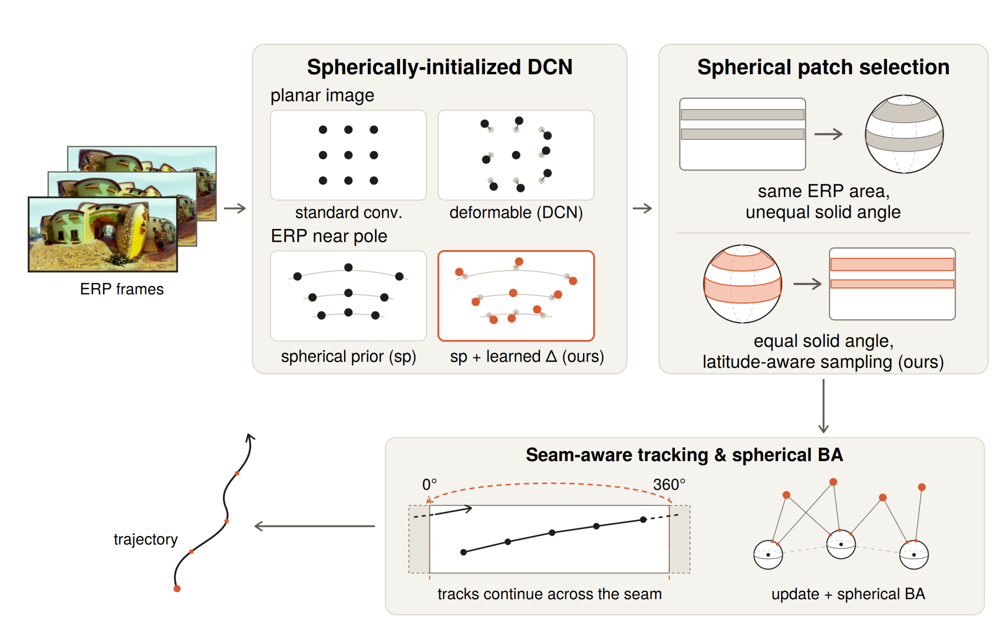

# DEFDVO: Deformable Deep Visual Odometry for Equirectangular Images (WACV 2027)

<p align="center">
  <a href="https://arxiv.org/abs/2611.19095"></a>
  <a href="https://buraksevsay.github.io/DEFDVO/"></a>
  <a href="https://huggingface.co/papers/2611.19095"></a>
</p>

This repository contains the official implementation of the paper:

> **[DEFDVO: Deformable Deep Visual Odometry for Equirectangular Images](https://arxiv.org/abs/2611.19095)**<br>
> Burak Sevsay, Egor Bondarev, Erkut Akdag<br>
> Eindhoven University of Technology<br>
> Accepted to WACV 2027 (Main Conference)

---

<p align="center">
  
</p>
<p align="center">
  <b>Figure 1.</b> DEFDVO overview. Given an equirectangular (ERP) stream, a spherically initialized deformable
  encoder extracts distortion-aware features, spherical-gradient selection samples informative patches on the
  viewing sphere, and seam-aware tracking with spherical bundle adjustment estimates the camera trajectory.
</p>

## Introduction

Omnidirectional (360°) cameras capture the full viewing sphere in every frame, so consecutive frames keep
overlapping even under large rotations. The equirectangular projection (ERP) used to store these images adds three
problems: distortion that grows with latitude, an artificial seam where the left and right image borders meet, and
oversampling of the polar regions.

DEFDVO is a monocular, patch-based deep visual odometry method that runs directly on ERP images. It builds on
[DPVO](https://github.com/princeton-vl/DPVO), replaces its pinhole camera model with an ERP camera model, and adds
three components:

1. **Spherically initialized deformable features:** DCNv2 layers start from the analytic SphereNet sampling pattern
   and learn latitude-conditioned residual offsets on top of it.
2. **Seam-aware estimation:** circular padding and correlation, and azimuth-wrapped residuals in bundle adjustment
   and in the training loss, so tracks continue across the seam.
3. **Spherical-gradient patch selection:** patch candidates are drawn uniformly on the sphere within ±75° latitude
   and ranked by feature gradient × cos(latitude).

**Main results**

- **TartanAirV2:** trained only on synthetic TartanAirV2 ERP images, DEFDVO reaches 0.042 m average ATE on the
  TartanAirV2 evaluation set (Set 1), 4.8× lower than the best prior result (0.201 m).
- **360DVO real-world benchmark:** lowest average ATE on both splits (3.26 m Easy, 3.29 m Hard).

## Environment Setup

```bash
# 1. Create the environment
conda env create -f environment.yml
conda activate defdvo

# 2. Build the CUDA extensions
pip install --no-build-isolation .
```

Tested with Python 3.12, PyTorch 2.10 and CUDA 13.0; building the extensions requires `nvcc`.

## Data Preparation

TartanAirV2 ERP images (`lcam_equirect`) are used for training and evaluation, and the 360DVO dataset for
evaluation. See [DATA.md](DATA.md) for downloading and preparing both datasets.

## Folder Structure

```
DEFDVO/
├── train.py                      # training on TartanAirV2
├── evaluate_tartan.py            # evaluation on TartanAirV2 Set 1 and Set 2
├── evaluate_360dvo.py            # evaluation on 360DVO
├── create_tartanairv2_pickle.py  # TartanAirV2 training index
├── config/default.yaml           # inference settings
├── dpvo/                         # model, ERP geometry, CUDA correlation and BA, data loading
├── assets/                       # figures
├── DATA.md                       # dataset download and layout
├── index.html, style.css         # project page (GitHub Pages)
├── environment.yml               # conda environment
├── setup.py                      # builds the CUDA extensions
└── LICENSE
```

## Usage

### Training

```bash
python train.py --name defdvo
```

The defaults follow the paper: 120k steps at image scale 0.5 (1024×512); training takes about two days on one
NVIDIA H100 GPU. Checkpoints are saved every 10k steps as `checkpoints/<name>_<step>.pth`; TensorBoard logs are
written to `runs/<name>`.

### Pretrained Model

Download `DEFDVO.pth` into `saved_checkpoints/` from either source:

- **GitHub:** [releases page](https://github.com/BurakSevsay/DEFDVO/releases)

  ```bash
  wget -P saved_checkpoints https://github.com/BurakSevsay/DEFDVO/releases/download/v1.0/DEFDVO.pth
  ```

- **Hugging Face:** [buraks1/DEFDVO](https://huggingface.co/buraks1/DEFDVO) (needs `pip install -U huggingface_hub`)

  ```bash
  hf download buraks1/DEFDVO DEFDVO.pth --local-dir saved_checkpoints
  ```

### Evaluation

```bash
python evaluate_tartan.py --weights saved_checkpoints/DEFDVO.pth   # TartanAirV2 Set 1 and Set 2
python evaluate_360dvo.py --weights saved_checkpoints/DEFDVO.pth   # 360DVO
```

Both scripts use the settings in `config/default.yaml`, run each sequence 5 times and report the median ATE and RPE
per sequence and their averages (paper protocol); the report is written to `saved_results/<name>.txt` (`--name`).
Options include `--split set1|set2` and `--scenes` (TartanAirV2), `--sequences` (360DVO), `--eval_scale` and
`--trials`; see `--help` for all.

## Results

Average ATE in meters (lower is better) on the real-world 360DVO benchmark and on the two TartanAirV2 evaluation
sets (Set 1: 360DVO split, Set 2: CubeDVO split). Avg. is the mean of the two split averages; see the paper for all
baselines.

| Method | 360DVO Easy | 360DVO Hard | 360DVO Avg. | TartanAirV2 Set 1 | TartanAirV2 Set 2 | TartanAirV2 Avg. |
|:--|:-:|:-:|:-:|:-:|:-:|:-:|
| 360DVO (default) | 3.60 | 6.06 | 4.83 | 0.202 | 0.142 | 0.172 |
| 360DVO (fast) | 5.94 | 3.45 | 4.70 | 0.201 | 0.421 | 0.311 |
| **DEFDVO** | **3.26** | **3.29** | **3.27** | **0.042** | **0.088** | **0.065** |

## Citation

If you find this repository useful, please consider citing:

```bibtex
@misc{sevsay2026defdvodeformabledeepvisual,
      title={DEFDVO: Deformable Deep Visual Odometry for Equirectangular Images},
      author={Burak Sevsay and Egor Bondarev and Erkut Akdag},
      year={2026},
      eprint={2611.19095},
      archivePrefix={arXiv},
      primaryClass={cs.CV},
      url={https://arxiv.org/abs/2611.19095},
}
```

## Acknowledgments

This code builds on [DPVO](https://github.com/princeton-vl/DPVO) by Zachary Teed, Lahav Lipson and Jia Deng and
includes [lietorch](https://github.com/princeton-vl/lietorch). The spherical sampling grid in `dpvo/spherenet` is
adapted from [sphereConv-pytorch](https://github.com/BlueHorn07/sphereConv-pytorch).

MIT License, see [LICENSE](LICENSE); `dpvo/lietorch` keeps its BSD 3-Clause license.
